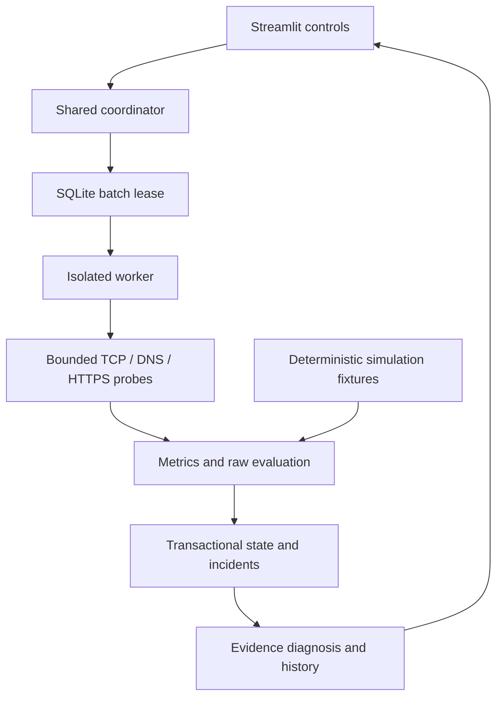

# Architecture and contracts

Existing app/config/engine/ui boundaries are retained; collector is renamed lowercase. Added files separate policies, route metadata, pure state transitions, transactional storage, process coordination and exports. No network scanning, ML or remote deployment layer was added.

## Flow

The worker returns only a completed JSON batch. It performs route discovery and at most four collector threads, which are joined before worker exit. The parent cancels/kills the entire worker at Stop/deadline. A crashed worker cannot publish a partial dataset. The DB lease expires in 120 seconds; the batch hard deadline is 90 seconds. Store updates are atomic, transactionally preventing duplicate active incidents and duplicate batch IDs. Freshness is a read-only presentation transform, not a historical rewrite.

## Normalized record

- Endpoint definition: `id`, `host`, `method`, `port`, `zone`, `scope`, `provider`, policy fields and optional explicit DNS resolver.
- Metrics: successful mean/median/min/max/p95, duration variation, counts, failure percentage, timeout count, error category counts, HTTP status, answering resolver and resolved IP.
- Samples: bounded `raw_samples` list, each with UTC timestamp, method outcome, successful duration or null, error and auxiliary evidence. This supports historical successful-sample statistics.
- `mode=live` or `simulation`; live packet-loss fields are null.
- `raw_status`: evidence-based current window classification.
- `status`: state transition after confirmation/hysteresis. `previous_status`, incident reference and UTC timestamp make recovery auditable.
- A malformed or unsupported observation becomes UNKNOWN; telemetry never fabricates values.

## State rules

| Observed window | Previous alert context | New state |
|---|---|---|
| No usable evidence / collector error | any | UNKNOWN; an unresolved severe incident still requires recovery |
| No successful required service checks | fewer than failure_windows consecutive severe windows | WARNING (pending confirmation) |
| No successful required checks | enough consecutive severe windows | UNREACHABLE service check; not proof host is down |
| Successful but critical duration / simulated packet loss | confirmed severe windows | CRITICAL, reachability separate |
| Some failures / warning duration / high variation | any | WARNING; recovery obligation preserved |
| Healthy raw checks after confirmed severity | duration still above recovery boundary | RECOVERING with zero confirmation count |
| Healthy raw checks below recovery boundary | fewer than recovery_windows cool windows | RECOVERING |
| Enough consecutive cool healthy windows | recovering incident | HEALTHY; incident RESOLVED |
| Measurement timestamp expired | presentation only | UNKNOWN + STALE; performance cards omit expired values |

Unknown/warning interruptions do not prematurely erase an incident's recovery obligation. Failed windows interrupt healthy recovery confirmation. Duplicate/old endpoint timestamps do not advance state; duplicate batch IDs are idempotent, out-of-order batches are rejected. A removed endpoint closes as a configuration change with recovery explicitly unverified. Acknowledgment changes incident workflow, not measurement state.

## Storage

Schema version 1 creates batches, measurements, per-endpoint state, incidents and one collection lease. UTC ISO 8601 timestamps have a consistent offset. Each measurement JSON carries unit-bearing field names and method, outcomes and evidence. Foreign-key cascading cleans measurement rows with batches. Indexed endpoint/time queries and bounded history reads limit dashboard work. Retention is age plus batch/incident count. Active incidents are retained until resolution/removal and are bounded by the allowlist. Physical SQLite pages are reused rather than automatically compacted.

This is a single-host SQLite design. Do not share a WAL database over a network filesystem. Choose one periodic collector. Cross-process lease tests establish no simultaneous batches, not distributed exactly-once scheduling.
